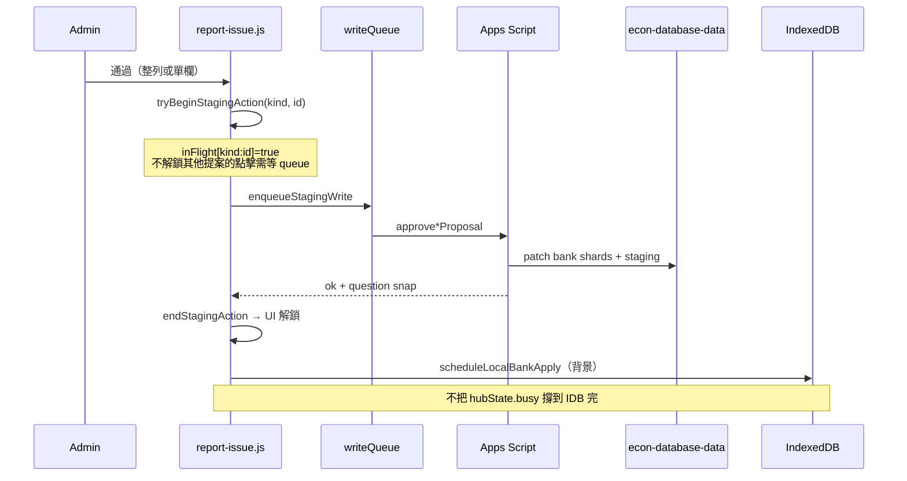

# report-issue.kb.md — 回饋／回報 hub

> 程式：`js/report-issue.js`  
> 相關：[`docs/classification-proposals.md`](../docs/classification-proposals.md)、[`apps-script/Code.kb.md`](../apps-script/Code.kb.md)

## 流程

Admin hub「審批與回報」四個 tab：`issues`（問題回報）｜`ai`（AI解釋 Feedback）｜`parts`（分題審批）｜`classification`（分類審批）。

### 分類／分題審批（approve）

### Soft pause banner

- `classPendingCount >= classPauseThreshold`（預設 **200**）→ 顯示暫停橫幅  
- Intake（`submitClassificationProposal`）仍接受；此為審批 backlog 提醒

## 架構取捨／決策

| 選項 | 選擇 | 原因 |
| --- | --- | --- |
| 整 hub `busy` 擋住所有審批直到 IDB refresh | **否**（PR #78） | 本機 `getAll`＋列表重繪很慢；人已確認 staging 寫入即可點下一題 |
| 全域 busy vs per-proposal in-flight | **per-proposal `inFlight`** + 選用 `hubState.busy`（issues／AI 批量等） | 同提案防雙點；不同提案可在上一筆 **網路寫入** 結束後點 |
| 並行寫 staging／bank | **`enqueueStagingWrite` 串列** | 避免同檔 409 |
| IDB 套用時機 | **`scheduleLocalBankApply` 背景**（`.catch` 吞錯） | 解鎖與 UI 不依賴本地鏡像完成 |
| 分類欄位 | `CLASS_FIELD_META`：always-eligible vs blank-only | 與 Apps Script／`docs/classification-proposals.md` 對齊 |
| 通過後清空欄位 | 需 confirm | 避免誤清 bank |

## 修改史（決策型）

| 何時／PR | 方向改變 |
| --- | --- |
| 分類 staging 落地 | 分類不再直寫 bank；hub 加「分類審批」 |
| 多分欄 approve | 每欄「通過此欄／保留原值」；partial 留下剩餘欄 |
| PR #78（`.28`） | **Approve unlock**：staging 成功即 `endStagingAction`；IDB apply 背景化；寫入佇列＋per-proposal in-flight |

## 待辦

- [ ] 大批量分類通過時的進度／取消 UX（待核實需求）
- [ ] issues／AI tab 是否也需要 per-item in-flight（目前多用 `hubState.busy`）

## 文字版 E2E 測試描述

1. 以 admin 登入 → 開「回饋／回報」→「分類審批」。  
2. 對一筆 pending：點「通過」；確認橫幅「已通過並寫入題庫」後，**不必等列表完全重載** 即可對**另一筆**再點通過（同筆不可連點）。  
3. 單欄：對 blank-only 且題庫已有值的欄，「通過此欄」應略過／禁用；always-eligible 已有值時應跳出覆寫確認。  
4. pending ≥200 時應見暫停橫幅；另用 agent 再 submit 一題仍應成功（`paused:true`）。  
5. 分題審批：已有分題題目應 `needsConfirm`；拒絕只刪 staging、不改 bank。
