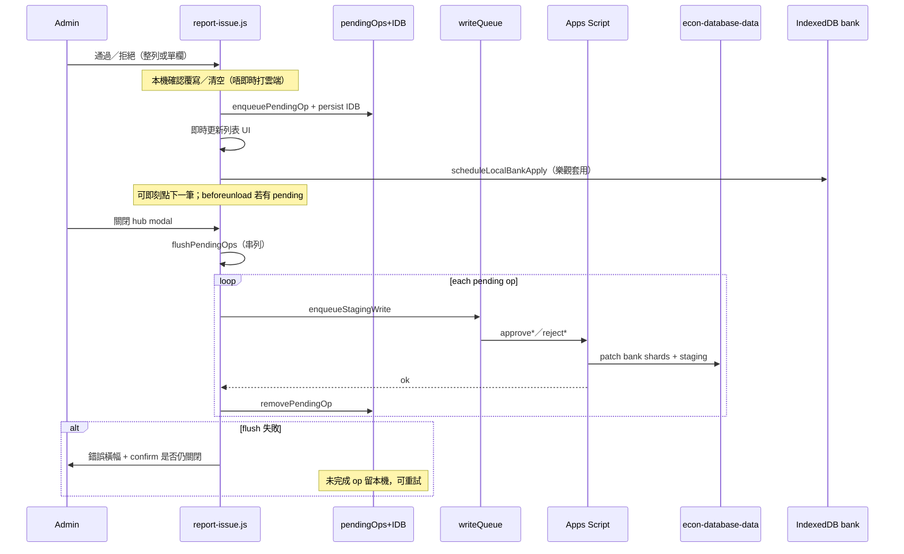

# report-issue.kb.md — 回饋／回報 hub

> 程式：`js/report-issue.js`  
> 相關：[`docs/classification-proposals.md`](../docs/classification-proposals.md)、[`apps-script/Code.kb.md`](../apps-script/Code.kb.md)

## 流程

Admin hub「審批與回報」四個 tab：`issues`（問題回報）｜`ai`（AI解釋 Feedback）｜`parts`（分題審批）｜`classification`（分類審批）。

### 分類／分題審批（approve／reject）— local-first queue

- **批量通過**（`bulkApprove*`）仍即時打雲端；若本機仍有 pending，會提示先關閉同步。
- Soft refresh／關頁：pending 存 `EconFeedbackHubPending`（IndexedDB；失敗時 fallback `localStorage`）。

### 兩套同步邏輯（hub vs 題目 tab）

| 場景 | 行為 |
| --- | --- |
| **Hub「審批與回報」內** | local-first（`.29`）：approve／reject → `pendingOps`；**唔**逐點上雲；**關閉 modal** 時串列 `flushPendingOps`；關窗失敗／仍有 pending → in-app confirm |
| **題目 tab ✓／✕（hub 外）** | 同樣先 `enqueuePendingOp`（樂觀 UI）；之後跟 **`readAutoSync()`**（`econ_git_auto_sync`／header「自動同步」checkbox，同 `github-sync.js`） |
| ↳ 自動同步 **開** | 即刻 `flushPendingOps({ reason: 'auto-sync' })`（經 `enqueueStagingWrite` 防 409）；**唔使開 hub** |
| ↳ 自動同步 **關** | 留本機 queue；header chip「待上傳審批 N」＋「立即上傳」；或再開自動同步後下次外層操作／手動上傳 |
| **兩者** | 有 unsynced pending → `beforeunload`；flush 失敗保留 pending＋TC 錯誤＋chip 可重試 |

### 題目 tab 卡上 ✓／✕（`.30`／`.31`）

- Admin（`rights.admin`）`ensureStagingCache` 拉 `listClassificationProposals`／`listQuestionPartsProposals`。
- 有 pending → 卡上「待審批分類」／「待審批分題」＋✓／✕；無 pending → UI 不變。
- ✓／✕ = one-shot 整單通過／拒絕（重用 hub `approve*Proposal`／`reject*Proposal`）；**唔**做 per-field。
- 外層入口：`handleCardStagingAction`（讀 `isGitAutoSyncOn()` → `readAutoSync`）。
- `ReportIssue.stagingActionsHtml`／`refreshQuestionCardStaging` 畀 `render.js`／`main.js`。

### Soft pause banner

- `classPendingCount >= classPauseThreshold`（預設 **200**）→ 顯示暫停橫幅  
- Intake（`submitClassificationProposal`）仍接受；此為審批 backlog 提醒
- 本機 queue **不**減少其他 admin 所見的雲端 pendingCount，直至 flush

## 架構取捨／決策

| 選項 | 選擇 | 原因 |
| --- | --- | --- |
| Hub 內每點即時上雲 | **否**（local-first） | 點擊要即時；網路／GitHub 寫入慢 |
| Hub 何時 flush | **關閉 hub modal** | session 多筆審批，關窗串列寫入 |
| 題目 tab（hub 外）何時上雲 | **跟「自動同步」**（`readAutoSync`）；關則 queue＋「立即上傳」chip | 唔另造設定；唔強迫開 hub |
| 持久化 pending | **IndexedDB `EconFeedbackHubPending`**（+ localStorage fallback） | soft refresh 唔好無聲丟工 |
| 離開頁警告 | **`beforeunload` 僅在有 unsynced pending** | 瀏覽器多忽略自訂字串，仍要 wire；flush 失敗另用 in-app confirm |
| 多 admin 一致性 | **接受 flush 前 staleness** | 他機會仍見未 flush 嘅 staging；文件化風險 |
| 並行寫 staging／bank | **`enqueueStagingWrite` 串列**（flush 時） | 避免同檔 409 |
| 樂觀 bank IDB | **enqueue 時即 `scheduleLocalBankApply`** | 列表外題庫 UI 即時反映；flush 成功再用 server snap 覆寫 |
| 整 hub `busy` 擋到 IDB | **否**（PR #78 起） | 本機 getAll 慢 |
| 分類欄位 | `CLASS_FIELD_META`：always-eligible vs blank-only | 與 Apps Script／docs 對齊 |
| 通過後清空欄位 | 需 confirm | 避免誤清 bank |
| 題目卡審批 | **✓／✕ one-shot**（admin only） | 睇題時快批；邏輯同 hub queue |

## 修改史（決策型）

| 何時／PR | 方向改變 |
| --- | --- |
| 分類 staging 落地 | 分類不再直寫 bank；hub 加「分類審批」 |
| 多分欄 approve | 每欄「通過此欄／保留原值」；partial 留下剩餘欄 |
| PR #78（`.28`） | **Approve unlock**：staging 成功即解鎖；IDB apply 背景化；寫入佇列＋per-proposal in-flight |
| `.29` local-first | **Approve／reject 先入本機 queue**；關 hub 先 flush；IDB 持久化；`beforeunload`；多 admin staleness 接受 |
| `.30` 題目卡 ✓／✕ | 題目 tab 卡對 pending 分類／分題 one-shot 入同一 pendingOps；無 pending 唔顯示 |
| `.31` hub vs 外層同步 | Hub 維持關窗 flush；題目 tab 跟 `readAutoSync` 即時 flush 或留 queue＋chip |

## 待辦

- [ ] 大批量分類通過時的進度／取消 UX（待核實需求）
- [ ] issues／AI tab 是否也需要 per-item in-flight／local queue（目前多用 `hubState.busy` 即時雲端）
- [ ] flush 中「取消其餘」按鈕（而家只暫停喺失敗／取消覆寫）
- [ ] 題目列表「只睇待審批」篩選（跟進）

## 文字版 E2E 測試描述

1. 以 admin 登入 → 開「回饋／回報」→「分類審批」。  
2. 對一筆 pending：點「通過」；橫幅應似「已通過（本機）…待同步」；**唔應**等網路即可對另一筆再點通過。  
3. Soft refresh（F5）後再開 hub：先前本機通過嘅提案唔應再出現喺列表（pending 由 IDB 還原並套用）；橫幅提示待同步。  
4. 關閉 hub：應見「正在同步至雲端（i／n）」→ 成功訊息；再開 hub／另一瀏覽器應反映雲端已審批。  
5. 模擬 flush 失敗（斷網後關閉）：應錯誤橫幅、唔宣稱成功；confirm 後可關閉；pending 仍在；恢復網路再關可重試。  
6. 有 pending 時重新整理／關 tab：應觸發瀏覽器 leave warning（`beforeunload`）。  
7. 單欄：blank-only 且題庫已有值 →「通過此欄」略過／禁用；always-eligible 已有值 → 覆寫確認（喺 enqueue 前）。  
8. pending ≥200 時應見暫停橫幅；另用 agent 再 submit 一題仍應成功（`paused:true`）。  
9. 分題審批：本機已有分題 → 覆寫 confirm 後入 queue；拒絕只喺 flush 後刪 staging、不改 bank。  
10. 有本機 pending 時按「通過全部」批量：應提示先關閉同步，唔直接批量。

11. 題目 tab（admin）：有 pending 見「待審批…」✓／✕；非 admin／無 pending → 唔見。  
12. **自動同步開**：卡上 ✓ → toast 上傳中 → 成功後 chip 清空；**唔使**開「審批與回報」。  
13. **自動同步關**：卡上 ✓ → 入本機佇列、chip「待上傳審批」；按「立即上傳」或稍後再開自動同步；關頁有 beforeunload。  
14. Hub 內通過多筆 → **唔**因自動同步而逐點上雲；只喺關 hub 時 flush。  
15. 同一題分類＋分題：兩行各自 ✓／✕。  
16. 斷網＋外層自動同步開：flush 失敗 → 錯誤 toast、pending／chip 保留；恢復後「立即上傳」成功。
