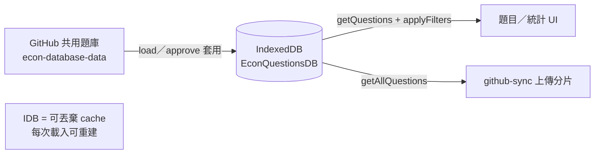

# storage-core.kb.md — IndexedDB 本地鏡像

> 程式：`js/storage-core.js`  
> `applyFilters`／`getUniqueValues` 由 `js/storage-filters.js` 掛上同一 class  
> 同步寫入／戳記：`js/storage-sync.js`、`js/schema-version.js`

## 流程

- DB version **4**：已刪除 publishers／topics／concepts／patterns 等舊 object store  
- 寫入前 `prepareQuestionForWrite`：mock 年份正規成 `MT##`

## 架構取捨／決策

| 選項 | 選擇 | 原因 |
| --- | --- | --- |
| IDB 當真相來源 | **否** | 真相在 GitHub；IDB 加速篩選與離線操作感 |
| 上傳用「畫面上篩過的列」 | **否**；用 `getAllQuestions()` | 避免權限／篩選導致上傳抹掉看不到的列 |
| metadata stores | **移除（v4）** | 「添加備註」已刪；降複雜度 |
| 啟動中 getQuestions | DB 未開 → **回 []** | 比 throw 安全 |

## 修改史（決策型）

| 方向 | 說明 |
| --- | --- |
| 去掉 legacy metadata stores | version bump 觸發 onupgradeneeded 清理 |
| year normalize on write | 與表單／bulk／import 一致，避免 bare mock 年份回流 |

## 待辦

- [ ] 大題庫時 `getAll`＋記憶體 filter 的效能（若再優化需另決策）  
- [ ] approve 後局部 `put` vs 全量重建的一致性檢查

## 文字版 E2E 測試描述

1. 清空站點資料後重新登入載入：IDB 應被題庫填滿；失敗時頁面應無題（不落回本 repo 檔案）。  
2. 儲存 mock 年 `39` → 讀回應為 `MT39`（或等價 normalize）。  
3. 套用篩選後 `getQuestions` 筆數減少；`getAllQuestions` 仍為全庫。  
4. Admin 上傳前即使 UI 有篩選，上傳集合應含未顯示列（與權限設計一致）。
